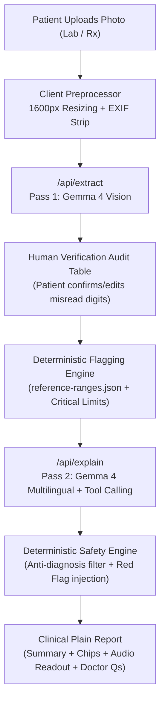

# Doc Decoder 🩺

> **Human-in-the-Loop Clinical Document Translator**  
> *Turn a photo of a lab report or prescription into a plain-language explanation in your chosen language, with deterministic medical safety guardrails.*

---

## 💡 Core Philosophy

> **"AI does perception and language; code does judgement and safety."**

Doc Decoder strictly decouples AI capability from clinical decision rules:
- **Multimodal AI (Gemma 4)** handles visual OCR, structured JSON extraction, and compassionate multilingual synthesis.
- **Deterministic TypeScript code** enforces name normalization, range checking, critical red-flag alerts, and forbidden diagnosis filters.
- **The Human-in-the-Loop**: The patient audits and confirms all extracted values in an editable verification table before any medical explanation is generated.

---

## 🏛️ System Architecture



---

## 🚀 Key Features

1. **Gemma 4 Multimodal Vision Core**:
   - Ingests complex multi-row lab tests, units, and printed reference limits.
   - Preserves numerical integrity with strict honesty rules (`null` if smudged/unreadable).
2. **Function Calling (`lookup_reference_range`)**:
   - Agentic tool calling when reference ranges are missing or blurred on physical reports.
3. **Deterministic Flagging Engine**:
   - Compares observed values against 30+ standardized tests across CBC, LFT, KFT, Diabetic, Lipid, and Thyroid profiles.
   - Instantly detects life-critical thresholds (e.g., severe hypokalemia, dangerous hyperglycemia).
4. **Safety & Compliance Post-Processing**:
   - Prohibits medical diagnoses ("You have X disease") and dosage modifications.
   - Enforces educational, doctor-empowering framing.
5. **Fail-Safe Demo Suite**:
   - Pre-loaded golden test suite (Anemia CBC, Diabetic Profile, Critical Potassium Alert, Decoded Prescription) for high-stakes, 100% reliable stage demonstrations.
6. **Zero-Data Privacy**:
   - Stateless serverless monolith: zero disk storage, zero database logging, in-memory processing only.

---

## 🛠️ Tech Stack

- **Framework**: Next.js 15 (App Router, Serverless Monolith)
- **Language**: TypeScript (Strict typing & Zod schema validation)
- **Styling**: Handcrafted Swiss-Clinical Design System (Vanilla CSS, Zero generic AI templates)
- **AI SDK**: Official `@google/generative-ai`
- **Typography**: Plus Jakarta Sans, JetBrains Mono, Newsreader

---

## ⚡ Quickstart

### 1. Clone & Install
```bash
git clone <repo-url>
cd "doc decoder"
npm install
```

### 2. Configure Environment
Copy `.env.example` to `.env.local`:
```bash
cp .env.example .env.local
```

Edit `.env.local` with your Gemini API key:
```env
GEMINI_API_KEY=AIzaSy...your_gemini_api_key...
GEMINI_MODEL=gemini-2.5-flash
```

*(You can also use `gemma-4-31b-it` or `gemma-4-26b-a4b-it` when available in your API project).*

### 3. Run Locally
```bash
npm run dev
```
Open [http://localhost:3000](http://localhost:3000) in your browser.

---

## 🎯 Hackathon Presentation Script (2-Minute Demo)

1. **Hook**: "Millions struggle to understand lab reports. Most AI solutions hallucinate diagnoses, which is dangerous."
2. **Step 1 (Ingest)**: Click the **"Critical Lab Value Alert Demo"** or **"Complete Blood Count"** preset in the top bar.
3. **Step 2 (Audit)**: Point out the editable table: *"Notice how the user verifies the digits first. AI does perception; code does judgement."*
4. **Step 3 (Explain)**: Click **"Confirm & Generate Plain Explanation"**.
5. **The Reveal**: Show the instant plain-language explanation, the urgent red-flag banner, the audio read-aloud button, and the copyable **"Questions for Your Doctor"** checklist.
